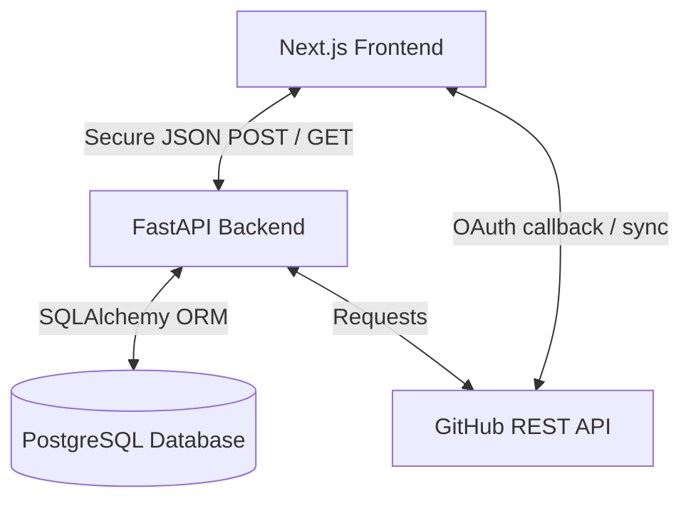

# Meridian File Structure & Architecture Directory

This document details the project structure, the role/responsibility of each file, and the architectural design of **Meridian**.

---

## 🏗️ System Architecture Overview

Meridian is built using a modern decoupled architecture:
1. **Frontend (Next.js 16 + React 19 + TypeScript)**: A client-side developer intelligence workspace styled with a premium dark glassmorphic design and responsive micro-animations using Framer Motion and TailwindCSS. Authentication is managed securely via **NextAuth** integrating with **GitHub OAuth**.
2. **Backend (FastAPI + SQLAlchemy + PostgreSQL)**: A high-performance Python API that handles user persistence, repository indexing, commit ingestion, database transactions, and integrates with the external **GitHub REST API**.
3. **Database Migration (Alembic)**: Versioned database schemas ensuring incremental migrations.



---

## 📂 Root Files

- [`.gitignore`](file:///c:/Users/pabhi/Desktop/GitRecall/.gitignore): Defines files, directories, dependencies (e.g. node_modules, Python venvs, environment variables) to exclude from version control.
- [`README.md`](file:///c:/Users/pabhi/Desktop/GitRecall/README.md): Primary project documentation outlining introduction, features, local setup, and run instructions.
- [`FILE_STRUCTURE.md`](file:///c:/Users/pabhi/Desktop/GitRecall/FILE_STRUCTURE.md): This file — documenting the workspace files, structural roles, and system architecture.

---

## 🐍 Backend Architecture (`/backend`)

The Python backend is structured modularly following standard enterprise patterns:

```
backend/
├── alembic.ini                   # Alembic migration configuration
├── requirements.txt               # Backend dependencies
├── alembic/                       # Schema migrations folder
└── app/
    ├── main.py                    # App entry point
    ├── core/                      # Core configuration and settings
    ├── db/                        # Database connection & setup
    ├── models/                    # SQLAlchemy models (Database schema definition)
    ├── schemas/                   # Pydantic schemas (Request/Response validation)
    └── services/                  # Business logic & GitHub REST API ingestion
```

### ⚙️ Backend Core Configuration & Database Setup
- [`backend/alembic.ini`](file:///c:/Users/pabhi/Desktop/GitRecall/backend/alembic.ini): Configures Alembic migration environment and database connection pointer.
- [`backend/requirements.txt`](file:///c:/Users/pabhi/Desktop/GitRecall/backend/requirements.txt): Lists Python modules and exact package versions required (e.g., FastAPI, SQLAlchemy, Alembic, psycopg2-binary).
- [`backend/app/main.py`](file:///c:/Users/pabhi/Desktop/GitRecall/backend/app/main.py): Sets up the FastAPI application instance, registers CORS middleware for frontend communication, and mounts the API routers under `/auth`, `/repository`, and `/commits`.
- [`backend/app/core/config.py`](file:///c:/Users/pabhi/Desktop/GitRecall/backend/app/core/config.py): Employs `pydantic-settings` to load and validate environment variables (like `DATABASE_URL`) from the backend `.env` file.
- [`backend/app/db/database.py`](file:///c:/Users/pabhi/Desktop/GitRecall/backend/app/db/database.py): Establishes the SQLAlchemy engine, configures `SessionLocal` (factory to generate database sessions), and exposes the declarative `Base` model and the `get_db` session utility function.
- [`backend/app/db/base.py`](file:///c:/Users/pabhi/Desktop/GitRecall/backend/app/db/base.py): Helper registry importing all SQLAlchemy models so that Alembic's autogenerate can detect database schema changes.

### 🗄️ Database Models (`backend/app/models/`)
These files define the PostgreSQL relational tables using SQLAlchemy ORM declarations:
- [`user.py`](file:///c:/Users/pabhi/Desktop/GitRecall/backend/app/models/user.py): Defines the `users` table, storing synced GitHub profile credentials (`github_id`, `username`, `avatar_url`) and referencing the repository relationship.
- [`repository.py`](file:///c:/Users/pabhi/Desktop/GitRecall/backend/app/models/repository.py): Defines the `repositories` table containing metadata (`name`, `full_name`, `description`, `language`, `stars`) and relating each repository to a `user_id` owner.
- [`commits.py`](file:///c:/Users/pabhi/Desktop/GitRecall/backend/app/models/commits.py): Defines the `commits` table mapping to standard commit structures (`sha`, `message`, `author_name`, `author_email`, `commit_timestamp`, `insertions`, `deletions`, `diff`) and foreign-keying to a parent `repository_id`.
- [`summary.py`](file:///c:/Users/pabhi/Desktop/GitRecall/backend/app/models/summary.py): Defines the `summaries` table containing AI-generated explanations of commits (`summary_text`, `summary_type`, `model_used`), connecting directly to a `commit_id`.

### 🛡️ Data Validation Schemas (`backend/app/schemas/`)
These files define Pydantic validation schemas to strictly validate request bodies and serialize responses:
- [`user.py`](file:///c:/Users/pabhi/Desktop/GitRecall/backend/app/schemas/user.py): Validation schemas for User data transfer objects (`UserCreate`, `UserResponse`).
- [`repository.py`](file:///c:/Users/pabhi/Desktop/GitRecall/backend/app/schemas/repository.py): Validation schemas for repository payloads, containing the `RepositorySyncRequest` (containing `token` and `user_id` for secure body POST validation) and `RepositoryResponse`.
- [`commit.py`](file:///c:/Users/pabhi/Desktop/GitRecall/backend/app/schemas/commit.py): Validation schemas for commits, including the `CommitSyncRequest` structure and `CommitResponse`.

### 🛣️ API Endpoints & Routes (`backend/app/api/routes/`)
Handles the request routing and coordinates business/service layers:
- [`auth.py`](file:///c:/Users/pabhi/Desktop/GitRecall/backend/app/api/routes/auth.py): Handles user login. If the user doesn't exist, it registers them, otherwise updates their profile data dynamically.
- [`repository.py`](file:///c:/Users/pabhi/Desktop/GitRecall/backend/app/api/routes/repository.py): Provides secure `/sync` POST endpoint to trigger repository synchronization using a POST request body, and a `GET` endpoint to retrieve active user repositories from the DB.
- [`commits.py`](file:///c:/Users/pabhi/Desktop/GitRecall/backend/app/api/routes/commits.py): Exposes secure `/sync` POST endpoint to ingest commits for a particular repository, and a `GET` endpoint to display commit histories from the database.

### 🧠 Service Logic & Ingestion Layer (`backend/app/services/`)
- [`github_service.py`](file:///c:/Users/pabhi/Desktop/GitRecall/backend/app/services/github_service.py): Encapsulates requests calling the external GitHub REST API securely to fetch user repositories (`get_user_repos`) and repository commits (`get_repo_commits`).
- [`repository_service.py`](file:///c:/Users/pabhi/Desktop/GitRecall/backend/app/services/repository_service.py): Implements database transactions for incoming repository arrays, handling automated upserts (updates existing repos or inserts new rows).
- [`commit_service.py`](file:///c:/Users/pabhi/Desktop/GitRecall/backend/app/services/commit_service.py): Handles transaction processing to batch insert incoming git commits, converting dates to timezone-aware timestamps and avoiding duplicates.

---

## 🎨 Frontend Architecture (`/frontend`)

The frontend is a next-generation workspace constructed using React, Next.js, and TypeScript. All network operations are strictly routed through our secure local backend API, keeping secret client tokens away from client-side direct external networks.

```
frontend/
├── tsconfig.json                 # TypeScript compiler setup
├── next.config.ts                # Next.js configuration
├── tailwind.config.js            # Tailwind theme tokens and layout setup
├── postcss.config.js             # PostCSS plugins
├── package.json                  # Frontend scripts & modules
├── app/                          # Next.js App Router (Pages, layout, global styling)
├── components/                   # Premium reusable visual components
└── types/                        # NextAuth & TypeScript definitions
```

### 🛣️ Pages & Routing (`frontend/app/`)
- [`layout.tsx`](file:///c:/Users/pabhi/Desktop/GitRecall/frontend/app/layout.tsx): Instantiates Google Fonts (Geist, Geist Mono), registers standard CSS styles, and wraps the tree inside next-auth providers.
- [`providers.tsx`](file:///c:/Users/pabhi/Desktop/GitRecall/frontend/app/providers.tsx): Initializes NextAuth's client `SessionProvider` globally.
- [`globals.css`](file:///c:/Users/pabhi/Desktop/GitRecall/frontend/app/globals.css): Declares root grid styling, tailwind utilities, and background gradients.
- [`page.tsx`](file:///c:/Users/pabhi/Desktop/GitRecall/frontend/app/page.tsx): Main landing page. Contains high-fidelity glassmorphism layers, glow circles, hero metrics, interactive feature overviews, and an OAuth CTA triggers.
- [`api/auth/[...nextauth]/route.ts`](file:///c:/Users/pabhi/Desktop/GitRecall/frontend/app/api/auth/[...nextauth]/route.ts): Handles client auth sessions. On successful sign-in, triggers an automatic POST call to the backend `/auth/login` to sync/persist the user profile and map the user ID to the local database.
- [`dashboard/page.tsx`](file:///c:/Users/pabhi/Desktop/GitRecall/frontend/app/dashboard/page.tsx): Authenticated workspace homepage. Syncs and loads repositories securely via a JSON body POST request to the local backend `/repository/sync`. Displays engineering stats, AI insight summaries, and responsive repository lists.
- [`repo/[name]/page.tsx`](file:///c:/Users/pabhi/Desktop/GitRecall/frontend/app/repo/[name]/page.tsx): Displays detailed project intelligence, including an interactive chronological timeline of synced commits, commit counts, and focus analytics.

### 🧱 Visual Interface Components (`frontend/components/`)
- [`LoginModal.tsx`](file:///c:/Users/pabhi/Desktop/GitRecall/frontend/components/LoginModal.tsx): An attractive authentication modal incorporating smooth motion fade-in, custom grid glows, benefit lists, and the NextAuth "Continue with GitHub" OAuth action.
- [`RepoCard.tsx`](file:///c:/Users/pabhi/Desktop/GitRecall/frontend/components/RepoCard.tsx): Premium glassmorphic cards representing active repositories, displaying descriptions, stars, and languages, linking users to repository details.
- [`Sidebar.tsx`](file:///c:/Users/pabhi/Desktop/GitRecall/frontend/components/Sidebar.tsx): A consistent side-navigation panel displaying app logos, system status, menu selections, and AI engineering activity recommendations.
- [`StatsCard.tsx`](file:///c:/Users/pabhi/Desktop/GitRecall/frontend/components/StatsCard.tsx): Display cards for developer stats (momentum percentage, active repo name, context switching metrics).
- [`Topbar.tsx`](file:///c:/Users/pabhi/Desktop/GitRecall/frontend/components/Topbar.tsx): Floating top navigation with interactive search, notifications, and user avatar details.

### 📐 TypeScript Definition Augmentations (`frontend/types/`)
- [`next-auth.d.ts`](file:///c:/Users/pabhi/Desktop/GitRecall/frontend/types/next-auth.d.ts): Augments standard `Session` and `JWT` interfaces to natively support custom fields (`accessToken`, `username`, `userId`), preventing TypeScript compilation errors and ensuring structural typing safety.
